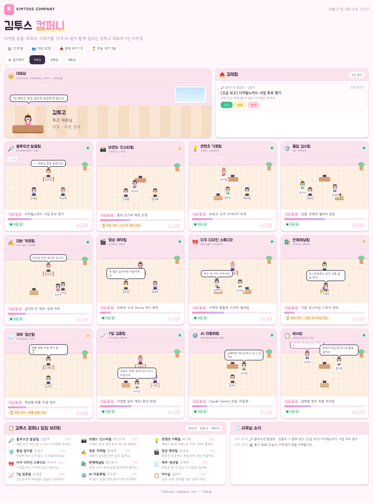

# 김투스 컴퍼니 — 1인 AI 사무실

12개 AI 팀이 일하는 모습을 도트 캐릭터 사무실로 보여주는 웹 화면입니다.



## 실행하기

```bash
npm install
npm run dev      # http://localhost:5173 에서 열림
```

배포용 빌드는 `npm run build` → `dist/` 폴더를 아무 정적 호스팅(Vercel, Netlify, GitHub Pages 등)에 올리면 됩니다.

## 고치는 곳은 한 파일뿐

**`src/company_config.ts`** 만 수정하세요. 회사 이름, 부서, 직원, 머리색, 혼잣말이 전부 여기 있어요.

- 부서 `id`는 바꾸지 마세요 (엔진이 이 id로 움직입니다).
- 부서는 12개 유지 (4열 × 3행 배치).
- 팀마다 팀장(`lead`) 1명.

## 화면에서 할 수 있는 것

| 기능 | 설명 |
| --- | --- |
| 🏢 사무실 | 직원들이 자리에서 일하고, 돌아다니고, 혼잣말을 해요. 캐릭터를 누르면 프로필이 떠요. |
| 📥 결재함 | 팀 업무 진행률이 100%가 되거나 수시로 팀장이 결재를 올려요. **승인 / 보류 / 반려** 를 누르면 팀장이 반응해요. |
| 📨 보고 요청 | 방 아래 버튼으로 그 팀에 바로 보고를 요청해요. |
| ⏳ 연동 대기 | `PENDING_INTEGRATIONS` 에 있는 팀은 주황불 + 업무 속도 절반. |
| 📋 일일 브리핑 | 팀장 한줄보고·진행률과 오늘 결재 집계. |
| ⏸ / 배속 | 시뮬레이션 일시정지, 1·2·4배속. |

결재 기록은 브라우저(localStorage)에만 저장됩니다. (데모 모드)

## 실제 AI 연동 모드 (LIVE)

Vercel에 아래 환경변수가 모두 있으면 결재함이 **LIVE** 로 바뀌고, 승인하면 Claude가 실제로 결과물을 만듭니다.

| 환경변수 | 내용 |
| --- | --- |
| `ANTHROPIC_API_KEY` | Claude API 키 (console.anthropic.com 에서 발급) |
| `CEO_PASSWORD` | 결재함 입장 비밀번호 (대표만 알고 있기) |
| `BLOB_READ_WRITE_TOKEN` | Vercel Blob 저장소 연결 시 자동 생성 |
| `DAILY_LIMIT` (선택) | 하루 최대 AI 작업 수, 기본 30 |
| `CLAUDE_MODEL` (선택) | 기본 `claude-opus-5-5` |

흐름:
1. 팀 방의 **보고 요청** → 팀장(Claude)이 구체적인 업무를 제안해 결재함에 올림
2. 대표가 **승인** → Claude가 그 팀으로서 결과물 작성 (보통 1~3분)
3. 결재함에 **완료 보고** → "결과 보기"로 전문 확인·복사
4. 또는 결재함 위 **업무 지시** 칸에 직접 지시하면 바로 작업 시작

안전장치: 결과물은 글(초안)만 만들고, 게시·업로드·결제·메시지 발송은 하지 않습니다. 그런 일은 "대표님이 직접 할 일"로 따로 적어 줍니다. 동시 작업 3건, 하루 한도 `DAILY_LIMIT`.

## 파일 구조

```
src/
  company_config.ts   ← 회사 설정 (여기만 고치면 됨)
  engine.ts           ← 시뮬레이션 엔진 (이동·혼잣말·진행률·결재)
  App.tsx             ← 화면 전체 배치
  components/         ← 캐릭터, 방, 결재함
  styles.css
  live.ts             ← 실제 AI 연동 클라이언트
api/
  tasks.ts            ← 결재함 API (제안·승인·지시·완료 보고)
  _lib/claude.ts      ← 팀별 Claude 프롬프트
  _lib/store.ts       ← Vercel Blob 저장
```
